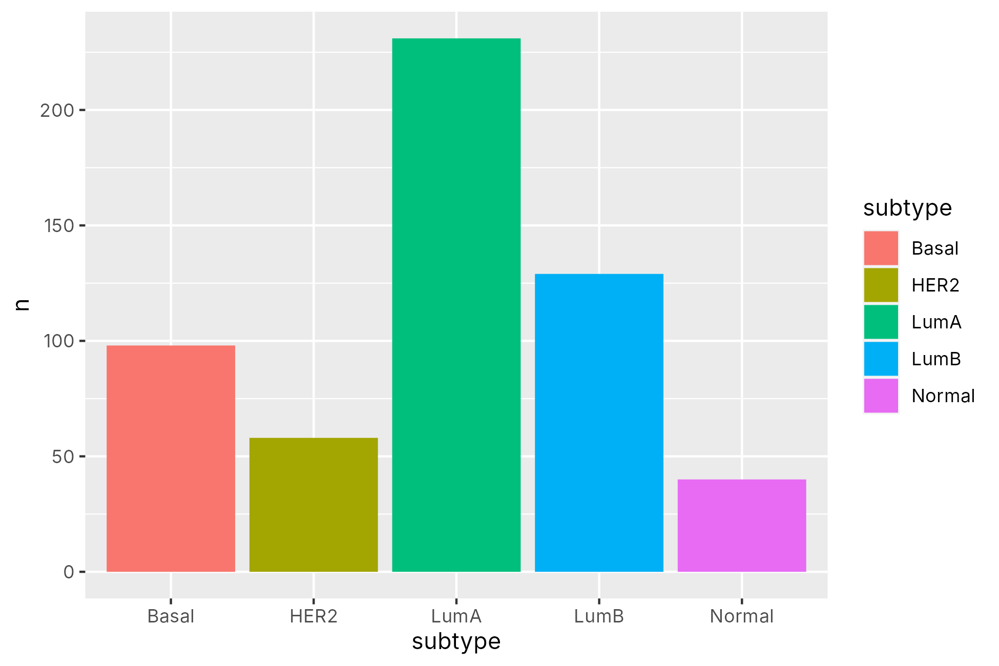
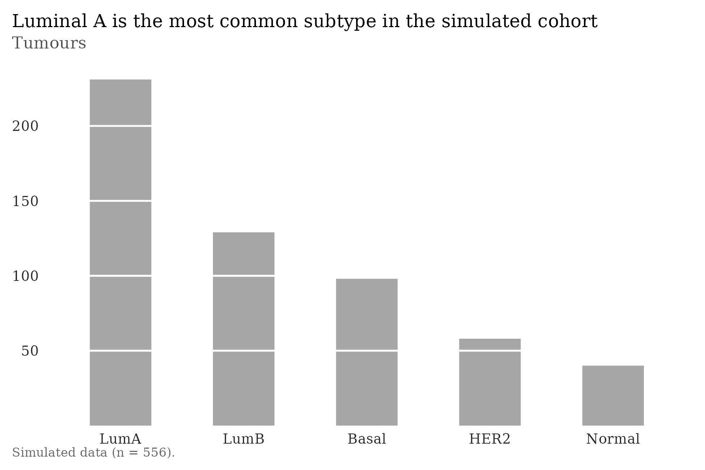

# InkSight

*Every drop of ink earns its place.*

InkSight is a Claude skill, plus plain R and Python helpers, for making statistical figures that follow the principles in Edward R. Tufte's *The Visual Display of Quantitative Information* (2nd ed., Graphics Press, 2001): show the data, tell the truth about it, and erase ink that carries no information.

| Default ggplot2 | With this skill |
|---|---|
|  |  |

More examples (all simulated data): [range-frame scatterplot](examples/output/02_scatter_range_frame.png), [quartile plot](examples/output/03_quartile_plot.png), [direct-labeled time-series](examples/output/04_lines_direct_labels.png), [small multiples](examples/output/05_small_multiples.png).

## What it does

- **Integrity checks:** `lie_factor()` (effect shown / effect in data, p.57), `deflate()` for constant and per-capita money (p.65-68), zero baselines for bars, no pies or 3-D.
- **Data-ink styling:** `theme_vdqi()` / `vdqi_style()` remove frames, backgrounds and grids; serif type; grays plus one colour-blind-safe accent; horizontal y labels; 1.5:1 shape.
- **Tufte's redesigns:** redesigned bar chart with white grid (p.126-129), quartile plot (p.123-125), range-frame scatterplot (p.130-132), direct-labeled time-series, small multiples (p.170-175).
- **Audit:** `audit_vdqi()` (R) and `audit_figure()` (Python) list rule violations in a figure, each with the book page.
- **Safe export:** `save_vdqi()` / `save_figure()` refuse to overwrite, reject odd paths and extensions, and strip software and date metadata.

Every rule, its page number, and how it is enforced is in [`references/principles.md`](references/principles.md).

## Install as a Claude skill

1. Download this repository as a ZIP (or use the `inksight.zip` release file).
2. In Claude, open **Settings > Capabilities > Skills** and upload the ZIP. The folder must contain `SKILL.md` at its root.
3. Ask for a figure, for example: "Plot tumour volume by treatment arm using the InkSight skill."

## Use directly in RStudio

```r
install.packages("ggplot2")            # once; >= 3.4.0
source("R/inksight.R")
p <- vdqi_lines(df, x = "day", y = "volume", group = "arm",
                highlight = "Drug A + B", ylab = "Tumour volume, cubic mm",
                title = "Combination therapy slows tumour growth most")
audit_vdqi(p)
save_vdqi(p, "fig_tumour.pdf")
```

## Use in Python

```python
import sys; sys.path.insert(0, "python")
import matplotlib.pyplot as plt, inksight as ink
with ink.vdqi_style():
    fig, ax = plt.subplots(figsize=ink.DEFAULT_SIZE)
    ink.quartile_plot({"Control": a, "Treated": b}, ylabel="LDL (mg/dL)", ax=ax)
    ink.save_figure(fig, "fig_ldl.png")
```

## Verify

```bash
Rscript tests/test_inksight.R      # base R only
python -m pytest -q tests/              # needs numpy, matplotlib, pytest
Rscript examples/demo.R                 # regenerates examples/output
```

The tests reproduce the book's own fuel-economy example (Lie Factor about 14.8) and check that each helper passes its own audit.

## Privacy and security

- No network access, shell calls, `eval`, or deserialization anywhere in the code; only `ggplot2` (R) or `numpy` and `matplotlib` (Python) are needed.
- Styling is scoped (a ggplot theme object, or a matplotlib context manager); global settings are not changed.
- Example data are simulated. `.gitignore` blocks data files and PDFs so datasets or source books are not committed by accident.
- The skill tells Claude never to label figures with personal identifiers and to warn about small cell counts (fewer than 11) in clinical or claims data.

## Credit and disclaimer

The design principles are those of Edward R. Tufte and are summarized here in original wording with page references for scholarly use. This project is independent and is not affiliated with or endorsed by Edward Tufte or Graphics Press. No text or images from the book are included; please buy the book. Code is released under the MIT License.
